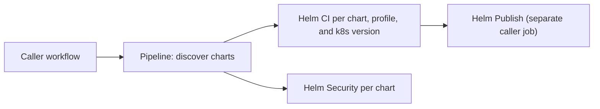

# Helm Chart Pipeline

The Helm chart pipeline tests, scans, and publishes Helm charts from a caller repository's `charts/` directory.

## Components

| Component | File | Role |
|---|---|---|
| [Pipeline](../2-workflows/2.1-pipeline-workflow.md) | `_managed-helm-pipeline.yml` | Detects changed charts, fans out to CI and security, and runs a repository secret scan |
| [Helm CI](../2-workflows/2.2-helm-ci-workflow.md) | `_managed-helm-ci.yml` | Lints, renders, validates, and packages one chart |
| [Helm Security](../2-workflows/2.3-helm-security-workflow.md) | `_managed-helm-security.yml` | Renders one chart and scans it with Trivy and Kubescape |
| [Helm Publish](../2-workflows/2.4-helm-publish-workflow.md) | `_managed-helm-publish.yml` | Pushes a packaged chart to an OCI registry |
| [helm-ci CLI](../3-cli/3.1-helm-pipeline-cli.md) | `helm-ci` package | Provides `chart-pipeline` and `security-scan` |
| [Example caller](../4-usage/4.1-example-caller.md) | `examples/helm-chart-ci/helm-chart-ci.yml` | Shows how a repository calls the pipeline |
| [Gitflow scenario](../4-usage/4.2-gitflow-scenario.md) | n/a | Explains which charts are tested with parallel feature branches |
| [Chart exclusions](../5-configuration/5.1-chart-exclusions.md) | n/a | Documents the `.ciignore` marker and the per-chart exception file |

## Flow

## Chart layout

Each chart lives at `charts/<name>/` and contains `Chart.yaml`.
