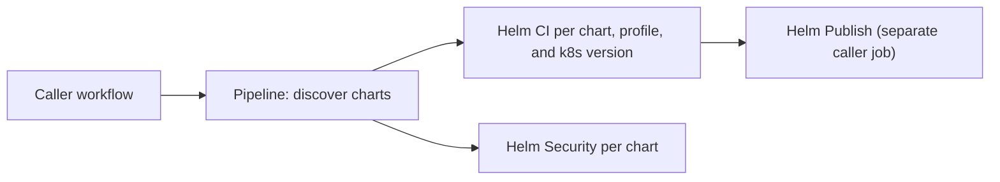

# Helm Chart Pipeline

The Helm chart pipeline tests, scans, and publishes Helm charts from a caller repository's `charts/` directory.

## Components

| Component | File | Role |
|---|---|---|
| [Pipeline](workflows/1.2-pipeline-workflow.md) | `_reusable-helm-pipeline.yml` | Detects changed charts and fans out to CI and security |
| [Helm CI](workflows/1.3-helm-ci-workflow.md) | `_reusable-helm-ci.yml` | Lints, renders, validates, and packages one chart |
| [Helm Security](workflows/1.4-helm-security-workflow.md) | `_reusable-helm-security.yml` | Renders one chart and scans it with Trivy |
| [Helm Publish](workflows/1.5-helm-publish-workflow.md) | `_reusable-helm-publish.yml` | Pushes a packaged chart to an OCI registry |
| [helm-ci CLI](cli/1.6-helm-pipeline-cli.md) | `helm-ci` package | Provides `chart-pipeline` and `security-scan` |
| [Example caller](usage/1.7-example-caller.md) | `examples/helm-chart-ci/helm-chart-ci.yml` | Shows how a repository calls the pipeline |
| [Gitflow scenario](usage/1.8-gitflow-scenario.md) | n/a | Explains which charts are tested with parallel feature branches |
| [Chart exclusions](configuration/1.9-chart-exclusions.md) | n/a | Documents the `.ciignore` marker and Trivy exception files |

## Flow

## Chart layout

Each chart lives at `charts/<name>/` and contains `Chart.yaml`.
