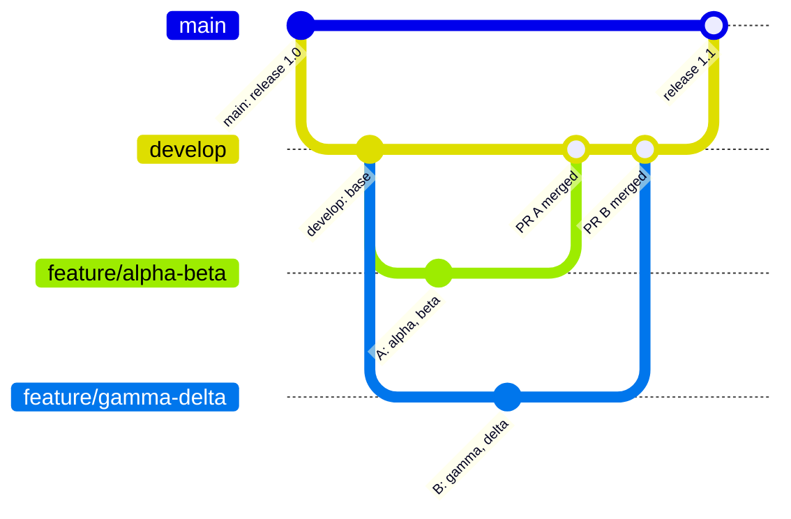
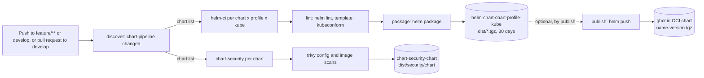

# Gitflow scenario: parallel chart changes

This page describes which charts the pipeline tests when two developers work on separate feature branches and merge into `develop`.

## Branch model

| Branch | Purpose | Pipeline trigger |
|---|---|---|
| `feature/**` | One feature per branch | Push runs [Helm CI](1.3-helm-ci-workflow.md) for changed charts |
| `develop` | Integration branch | Pull request to `develop` and push to `develop` |
| `main` | Release branch | Not a trigger in the [example caller](1.7-example-caller.md) |

## Pipeline jobs and versions

The [example caller](1.7-example-caller.md) (workflow name `Helm Chart CI`) calls `_reusable-helm-pipeline.yml` from `ITlusions/ITL.Github@main`. Every job checks out the caller repository, not `ITL.Github`. The `helm-ci` package is installed from `git+https://github.com/ITlusions/ITL.Github.git@main`, so changes to the scripts reach CI only after they are pushed to `main`.

| Order | Job | Reusable workflow | Runs when | Produces |
|---|---|---|---|---|
| 1 | `discover` | `_reusable-helm-pipeline.yml` | Always | Chart list and Kubernetes version list |
| 2 | `helm-ci` (one per chart, profile, and Kubernetes version) | `_reusable-helm-ci.yml` | Chart list is not `[]` | Artifact `helm-chart-<chart>-<profile>-<kube>` |
| 3 | `chart-security` (one per chart) | `_reusable-helm-security.yml` | One matrix entry per chart in the list | Artifact `chart-security-<chart>` |
| 4 | Publish (not in the example caller) | `_reusable-helm-publish.yml` | Only when a caller adds the job | Chart pushed to `ghcr.io` as OCI |

The caller sets `concurrency` to group `helm-ci-${{ github.ref }}` with `cancel-in-progress: true`, so a newer push to the same ref cancels the older run.

### Versions

| Component | Version | Where it is set |
|---|---|---|
| Helm | v4.3.2 | `helm-version` input of helm-ci and publish; `HELM_VERSION` env of security |
| Default Kubernetes version | 1.37.1 | `default-kube-version` input of the pipeline |
| Scheduled Kubernetes versions | 1.36.5 and 1.37.1 | `scheduled-kube-versions` input of the pipeline |
| kubeconform | v0.7.0 | `chart-pipeline setup-tools`, installed in `dist/tools` and added to `GITHUB_PATH` |
| helm-unittest plugin | v1.2.1 | `chart-pipeline setup-tools` |
| Trivy | v0.76.2 | `security-scan setup-tools --tool trivy` |
| Python | 3.12 | `actions/setup-python` in discover, the helm-ci lint job, and security |
| `actions/checkout` | v7.0.1 | Every job |
| `actions/setup-python` | v7.1.0 | Discover, helm-ci lint, security |
| `azure/setup-helm` | v5.1.0 | Helm-ci lint and package, security, publish |
| `actions/upload-artifact` | v7.0.2 | Helm-ci package, security |
| `actions/download-artifact` | v8 | Publish |

The package also pins gitleaks v8.30.1 (used by `security-scan secrets`), kind v0.33.0, and kubectl v1.36.5 (used by `setup-kind`). None of the reusable workflows in this page call those commands, so no job here runs them.

## How charts are selected

The pipeline compares the chart directories that changed between two commits. The base depends on the event:

| Event | Base revision | Charts tested |
|---|---|---|
| Pull request to `develop` | Branch point (`git merge-base origin/develop <head SHA>`), compared with the feature head and with `origin/develop` | Charts changed on the feature branch and on `develop` since the branch point |
| Push to `feature/**` | Merge base of `origin/develop` and `HEAD` | Charts changed on the feature branch |
| Push to `develop` | `github.event.before` (the tip before the push) | Charts changed by the pushed commits |
| Push to `develop` with no previous tip (first push of the branch) | `origin/main` | Charts that differ from `main` |

### Discover commands by event

The discover step checks these cases in order and runs the first one that matches. The `chart` input takes precedence over every other case.

| Case | Command |
|---|---|
| `chart` input is set | Validates `charts/<chart>` and returns it as the only chart. No change detection. |
| `full-scan` is true (schedule or manual run) | `chart-pipeline changed --all`. Kubernetes versions: scheduled list. |
| Push to `develop` | `chart-pipeline changed --base <github.event.before>` |
| Pull request | `chart-pipeline changed --base "$(git merge-base origin/develop $PR_HEAD_SHA)" --develop origin/develop` |
| Any other push (`feature/**`) | `chart-pipeline changed --base "$(git merge-base origin/develop HEAD)"` |

All runs except `full-scan` use the default Kubernetes version (1.37.1 in the example caller). Discover and security both run `pip install -r requirements-ci.txt`, so the caller repository must contain that file.

## Scenario

Developer A and developer B each change two charts on their own feature branch. Their branches both target `develop`.

| Chart | Changed by |
|---|---|
| `charts/alpha` | Developer A |
| `charts/beta` | Developer A |
| `charts/gamma` | Developer B |
| `charts/delta` | Developer B |

### Pull requests

Each pull request runs CI for its own charts and for any charts already merged into `develop` since its branch point. Developer A's PR tests `alpha` and `beta`. Developer B's PR tests `gamma` and `delta`, and also `alpha` and `beta` if A's merge reached `develop` after B branched. A PR whose branch point is after A's merge tests only `gamma` and `delta`.

### Merges into develop

The number of charts on the `develop` run depends on how the merges land:

| Merge pattern | Push to `develop` tests |
|---|---|
| A merged, then B merged in a separate push | 2 charts per push: `alpha`, `beta` on the first; `gamma`, `delta` on the second |
| Both merged in one push (one push covers both merge commits) | 4 charts: `alpha`, `beta`, `gamma`, `delta` |

The 4-chart run on `develop` only happens when both changes arrive in a single push. A separate merge gives a separate run with two charts.

### Changes already on develop

A pull request to `develop` tests charts changed on `develop` after its branch point, even when the feature branch does not change them. The discover step takes the branch point as `git merge-base origin/develop <pull request head SHA>` and selects the union of charts changed between the branch point and the feature head and between the branch point and `origin/develop`. If developer B's branch does not change `alpha` but `develop` does, B's PR tests `alpha`. Pushes to `feature/**` diff against `origin/develop` and do not include these changes; they are tested when the pull request runs.

### Going to main

The example caller does not run on pushes or pull requests to `main`. Release changes that reach `main` are not tested by the pipeline unless the caller adds a trigger for `main`. If the release is a merge from `develop` to `main`, the charts were already tested on `develop`.

## Testing all four charts on develop

To test every chart on `develop`, run the caller manually with `full-scan` set to true. This runs `chart-pipeline changed --all` and uses the scheduled Kubernetes versions. The caller's cron trigger `0 3 * * 1` (Mondays at 03:00 UTC) starts the same full scan.

The matrix size follows from the chart list, the profiles, and the Kubernetes versions:

| Run | Charts | Helm-ci jobs | Security jobs |
|---|---|---|---|
| Push to `develop` with `alpha` and `beta` changed, one profile | 2 | 2 (`1.37.1` only) | 2 |
| Full scan of four charts, one profile | 4 | 8 (4 charts × 2 Kubernetes versions) | 4 |

A single chart can be tested with the `chart` input instead, which overrides change detection.

## Visual overview

Branch flow for the two developers in the scenario:

Pipeline and artifacts for one push or pull request:

## Versions and artifacts

### Version handling

| Version | Source | Used for |
|---|---|---|
| Chart version | `version` in `Chart.yaml` | Package file name `<name>-<version>.tgz` and the OCI tag |
| Chart version override | `version` input of helm-ci and publish | helm-ci: passed to `helm package --version`. Publish: only used to select `dist/*-<version>.tgz` (see below) |
| Kubernetes version | `default-kube-version`, `scheduled-kube-versions` | Matrix dimension and `kubeconform -kubernetes-version` |
| Tool versions | Pins in `chart_pipeline.py` and `security_scan.py` | Helm, kubeconform, helm-unittest, Trivy |
| Action versions | Pins in the reusable workflows | Checkout, setup, upload, download |

The pipeline does not bump versions. The chart version is whatever the author commits to `Chart.yaml`, and the pipeline reads it as is. The `detect-version` workflow in `ITL.Github` is not called by the Helm pipeline.

Release tags of the form `chart/<name>/v<x.y.z>` are parsed by `chart-pipeline changed --tag` (`RELEASE_TAG`). No workflow in `ITL.Github` sets `RELEASE_TAG` or triggers on tags, so tags have no effect today.

Publish behaviour depends on where the package comes from:

- Artifact found (normal path): the `.tgz` built by helm-ci is pushed unchanged. The `version` input only filters `dist/*-<version>.tgz`. If it does not match the packaged version, the job fails with "No chart package found in dist/".
- No artifact and `fallback-build` is true: the chart is packaged from source, and `version` is passed to `helm package --version`.
- The workflow does not check whether the version already exists in the registry. The Python `check-version` guard in `chart_pipeline.py` is not called by the publish workflow.

Artifact names do not include the chart version. Each Kubernetes version in the matrix creates its own package artifact, all with the same `.tgz` file name. The publish workflow's default `artifact-name` (`helm-chart`) does not match the helm-ci artifact names, so callers must pass the matching name.

### Versioning examples

Assume `charts/alpha/Chart.yaml` contains `version: 0.3.0`.

| Scenario | Inputs | Package built | Pushed to |
|---|---|---|---|
| Default release | none | `alpha-0.3.0.tgz` | `oci://ghcr.io/<namespace>/alpha:0.3.0` |
| Override in helm-ci | helm-ci `version: 0.3.1-rc.1` | `alpha-0.3.1-rc.1.tgz` | not pushed by helm-ci |
| Publish matches artifact | publish `version: 0.3.0` | downloaded `alpha-0.3.0.tgz` | `oci://ghcr.io/<namespace>/alpha:0.3.0` |
| Publish mismatch | publish `version: 0.3.1` with artifact `alpha-0.3.0.tgz` | none selected | job fails: "No chart package found in dist/" |
| Fallback build | publish `version: 0.3.1`, no artifact | `alpha-0.3.1.tgz` | `oci://ghcr.io/<namespace>/alpha:0.3.1` |

To release a new version, change `version` in `Chart.yaml` in the feature branch and merge it through the normal gitflow. The version in `Chart.yaml` is then the version that helm-ci packages and publish pushes. Leave the `version` inputs empty so the two stay in sync.

Tool and action versions are pinned in `ITL.Github@main`. Changing a pin takes effect in every caller only after the change is merged to `main`.

### Artifacts created

| Artifact name | Contents | Retention | Produced by | Consumed by |
|---|---|---|---|---|
| `helm-chart-<chart>-<profile>-<kube>` (example: `helm-chart-alpha-basic-1.37.1`) | `dist/*.tgz`, the packaged chart | 30 days | helm-ci package job | Publish, only when `artifact-name` matches |
| `chart-security-<chart>` (example: `chart-security-alpha`) | `dist/security/<chart>/` JSON reports | Repository default | chart-security job | Downloaded manually from the run |
| OCI chart `ghcr.io/<namespace>/<chart>:<version>` | `<name>-<version>.tgz` | Until deleted in the registry | Publish job | Consumers of the chart |

The `rendered.yaml` output of the lint job is not uploaded. The package job does not upload anything else. Publish creates an OCI artifact in the registry, not a GitHub Actions artifact.

## Job steps

### helm-ci: lint

Each matrix entry (chart × profile × Kubernetes version) runs `_reusable-helm-ci.yml` with `chart-path`, `values-files` (the profile's values file), `kube-version`, and `artifact-name`. The lint job runs these steps:

1. Check out the caller repository (`actions/checkout` v7.0.1).
2. Install Helm v4.3.2 (`azure/setup-helm` v5.1.0).
3. Run `helm dependency build` on the chart.
4. Run `helm lint --strict` with the profile's values file.
5. Run `helm template ci-release <chart> --kube-version <kube>` and write the output to `rendered.yaml`.
6. Install Python 3.12 and `helm-ci` from git `main`.
7. Run `chart-pipeline setup-tools --directory dist/tools`, which installs kubeconform v0.7.0 and the helm-unittest plugin v1.2.1 and adds `dist/tools` to `GITHUB_PATH`.
8. Run `kubeconform -strict -summary -kubernetes-version <kube>` on `rendered.yaml`.

### helm-ci: package

The package job runs only after lint succeeds:

1. Run `helm package --destination dist/`, adding `--version` when the `version` input is set.
2. Upload `dist/*.tgz` with `actions/upload-artifact` v7.0.2. The artifact name is the matrix artifact name, the retention is 30 days, and a missing file fails the job.

For example, chart `alpha`, profile `basic`, and Kubernetes `1.37.1` produce the artifact `helm-chart-alpha-basic-1.37.1`.

### chart-security

Each chart in the list runs `_reusable-helm-security.yml` with `chart`. The steps are:

1. Check out the repository, install Helm v4.3.2, and install Python 3.12 with `requirements-ci.txt` and `helm-ci`.
2. Run `security-scan setup-tools --directory dist/tools --tool trivy`, which installs Trivy v0.76.2.
3. Run `security-scan chart <chart>`. This renders the chart and then:
   - Runs `trivy config --severity HIGH,CRITICAL --exit-code 1` on the rendered manifest. If `security/trivy-exceptions/<chart>.yaml` exists, it is passed as `--ignorefile`, and the excluded findings are written to `config-unfiltered.json`.
   - Collects the images from the default workloads (Deployment, DaemonSet, StatefulSet, ReplicaSet, ReplicationController, Job, CronJob, Pod) into `images.json`.
   - Runs `trivy image --scanners vuln --severity CRITICAL --ignore-unfixed --exit-code 1` on each image. Each image also gets a HIGH-severity report that does not fail the job.
   - Fails the job if any image scan fails.
4. Upload `dist/security/<chart>` as `chart-security-<chart>` with `if: always()`. A missing directory does not fail the upload.

Library charts are skipped by the security scan.

The security directory contains `config.json`, `config-unfiltered.json`, `images.json`, `image-<id>.json`, `image-high-<id>.json`, and `scan-errors.json` when a scanner fails. The `<id>` is a 16-character SHA-256 prefix, as in `image-<sha256[:16]>.json`.

Gitleaks is not part of the chart job. It runs only under `security-scan secrets`.

### publish

The publish reusable workflow is not called by the example caller. A caller that adds it passes these inputs:

| Input | Default | Meaning |
|---|---|---|
| `commit-sha` | (required) | Commit to publish |
| `chart-path` | `.` | Chart directory |
| `helm-version` | v4.3.2 | Helm version |
| `registry` | `ghcr.io` | OCI registry |
| `registry-namespace` | Repository owner, lowercased | Target namespace |
| `environment` | `production` | GitHub environment |
| `artifact-name` | `helm-chart` | CI artifact to reuse |
| `ci-workflow-name` | `Helm CI — Branch push` | CI workflow to search for the commit |
| `fallback-build` | `true` | Package the chart when no CI artifact exists |
| `version` | (empty) | Chart version override |

The steps are:

1. Find the latest successful CI run for `commit-sha` with `gh run list --commit <sha> --workflow <ci-workflow-name> --status success --limit 1`.
2. Download the artifact `artifact-name` from that run (`actions/download-artifact` v8).
3. If there is no run and `fallback-build` is true, check out the commit, install Helm, run `helm dependency build`, and run `helm package`.
4. Log in with `helm registry login ghcr.io`, using `github.actor` and `GITHUB_TOKEN`.
5. Run `helm push dist/<name>-<version>.tgz oci://ghcr.io/<namespace>`.

The job outputs `published` and `package` (`name-version`). It needs `contents: read`, `actions: read`, and `packages: write`.

The defaults do not match the pipeline. The default `artifact-name` is `helm-chart`, but helm-ci produces `helm-chart-<chart>-<profile>-<kube>`. The default `ci-workflow-name` is `Helm CI — Branch push`, but the example caller is named `Helm Chart CI`. A caller must pass both values explicitly, or the lookup falls back to a rebuild.

## Additional scenarios

### Change outside any chart

Developer C edits only `README.md` on `feature/docs`. The discover step finds no changed chart directories, so the chart list is `[]`. The helm-ci and chart-security jobs are skipped, and the run ends after discover.

### Hotfix branch

A hotfix for `charts/alpha` is created from `main` in a branch named `hotfix/alpha-ingress`. The example caller triggers on `feature/**`, `develop`, and pull requests to `develop`, so pushing the hotfix branch does not run the pipeline. Opening a pull request to `develop` does run it, and the discover step uses the branch point against `origin/develop`, so the pull request tests `alpha` as well as any other chart changed on `develop` since the branch point.

### Release merge from develop to main

The release pull request from `develop` to `main` does not trigger the pipeline. The charts in the release were tested on `develop` when their feature pull requests and the `develop` push ran. A regression introduced only by the merge commit is not caught, because nothing tests `main`.

### Two pushes to the same feature branch

Developer A pushes a fix to `feature/alpha-beta` while the first run is still in progress. The caller's concurrency group `helm-ci-refs/heads/feature/alpha-beta` cancels the older run. Only the newer run's artifacts and security reports are produced.

### Library chart in a feature branch

Developer D changes `charts/shared`, a chart with `type: library`. The discover step includes it, so helm-ci runs for it. The chart-security job skips library charts, so the run shows no `chart-security-shared` artifact. This is expected and is not a failure.

### Two main builds of the same release

The automatic versioning computes the release version from the highest `chart/<name>/v*` tag. Two pull requests merged to `main` before any tag exists for the next version both compute the same version. The first publish pushes the chart and creates the tag. The second publish finds the tag on origin and fails before pushing, so the duplicate version is never written to the registry. Re-running the second publish after the first one finished computes the next patch version and succeeds.

This case needs the `publish` job, which the example caller does not include.

### Feature branch pre-release versions

With automatic versioning, a push to `feature/alpha-beta` packages `alpha` with a pre-release version such as `0.3.1-feature-alpha-beta.42-1a2b3c4`. The slug is the branch name in lowercase with non-alphanumeric characters replaced by `-`, the number is the workflow run number, and the suffix is the first seven characters of the commit SHA. No tag is created for a pre-release.

The release version is still computed from tags and `Chart.yaml`, so the pre-release describes the next release, not the current one.
