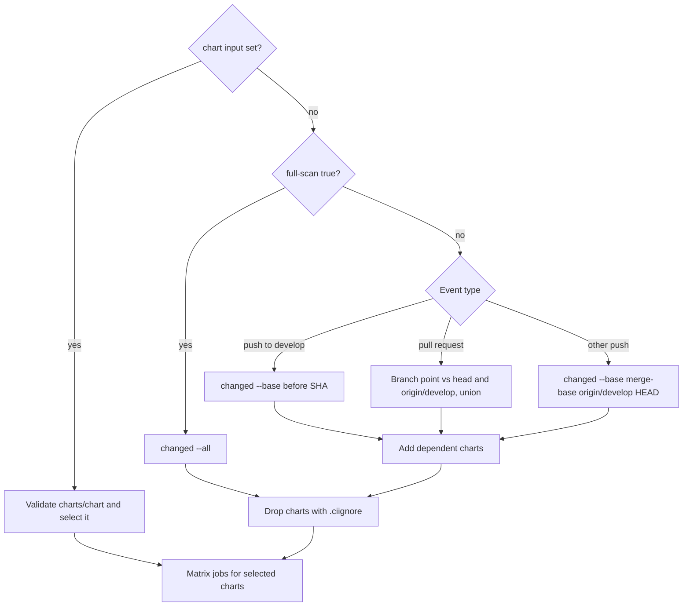

# Helm Chart Pipeline (reusable workflow)

**File:** `.github/workflows/_managed-helm-pipeline.yml`

Detects changed charts in the caller repository and runs Helm CI and security scans for each one.

## Inputs

| Input | Type | Default | Description |
|---|---|---|---|
| `full-scan` | boolean | `false` | Test every non-ignored chart instead of only changed ones |
| `default-kube-version` | string | `1.36.4` | Kubernetes version for push and pull request runs |
| `scheduled-kube-versions` | JSON array | `["1.36.4"]` | Kubernetes versions used when `full-scan` is true |
| `profiles` | JSON array | `[{"name":"basic","values":"values.yaml"}]` | Objects with `name` and `values` (path relative to the chart) |
| `chart` | string | `""` | Test only `charts/<chart>`; overrides change detection |
| `security-summary-layout` | string | `classic` | Job summary layout for security scans: `classic`, `flat`, `sections`, `counts` or `expiry` |
| `security-verify-exceptions` | boolean | `false` | Require a valid cosign signature bundle for each security exception file |

## Jobs

1. `discover` selects charts and Kubernetes versions.
2. `helm-ci` runs a matrix of chart × profile × Kubernetes version using [Helm CI](2.2-helm-ci-workflow.md).
3. `chart-security` runs a matrix of chart using [Helm Security](2.3-helm-security-workflow.md).
4. `repository-secrets` runs once per workflow run, regardless of chart selection. It scans the git history with gitleaks.

## Chart selection

- `chart` set: validates `charts/<chart>` exists and selects only that chart.
- `full-scan` true: runs `chart-pipeline changed --all`.
- Push to `develop`: compares against the push's `before` SHA.
- Pull request to `develop`: compares the branch point (`merge-base origin/develop <head SHA>`) against the feature head and against `origin/develop`, and selects the union of both.
- Other events: compares against the merge base with `origin/develop`.
- A push to `develop` with an all-zero `before` SHA (new branch) compares against `origin/main`.

A chart counts as changed when a file under `charts/<chart>/` differs from the base and `charts/<chart>/Chart.yaml` exists. Deleted charts are not selected.

## Dependent charts

For changed-chart selection, the pipeline also adds every chart that depends on a changed chart, following dependencies transitively. A dependency is matched by the `name` in the dependent chart's `dependencies` list against the chart's `name` in `Chart.yaml`. Dependents are added before `.ciignore` is applied, so an ignored dependent is not tested even when its dependency changed.

The `chart` input and `full-scan` do not use this expansion. `full-scan` selects every non-ignored chart.

## Ignored charts

Charts with a `.ciignore` file are excluded from every selection above, except when `chart` is set. See [Chart exclusions](../5-configuration/5.1-chart-exclusions.md).

If no chart is selected, the matrix jobs are skipped. The `repository-secrets` job still runs.

## Cost estimate

GitHub Actions bills per job minute on hosted runners, rounded up per job. All jobs run on `ubuntu-latest`. The rate used here is about $0.006 per Linux minute for private repositories. Public repositories use standard runners for free. Verify the current rate on the Actions billing page before relying on these figures.

Cost = (total job minutes) × $0.006

Assumed job durations (not measured; replace with real run data):

| Job | Minutes per job |
|---|---|
| `discover` | 2 |
| `helm-ci` (three jobs per chart × profile × Kubernetes version) | 12 |
| `chart-security` (per chart) | 5 |
| `repository-secrets` | 2 |

| Scenario | Combinations | Minutes | Cost |
|---|---|---|---|
| Push or PR, 1 changed chart, 1 profile, 1 Kubernetes version | 1 | about 21 | about $0.13 |
| Push or PR, 20 changed charts, 1 profile, 1 Kubernetes version | 20 | about 344 | about $2.06 |
| Full scan, 20 charts, 2 profiles, 2 Kubernetes versions | 80 | about 1,064 | about $6.38 |

Cost grows with the chart × profile × Kubernetes version matrix. Each extra profile or Kubernetes version adds about $1.44 for 20 charts. Concurrency limits on the plan can lengthen wall-clock time but do not change billed minutes.
