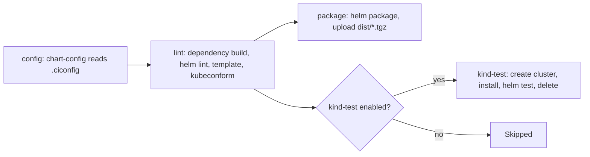

# Helm CI (reusable workflow)

**File:** `.github/workflows/_managed-helm-ci.yml`

Lints, renders, validates, and packages one chart. The packaged chart is uploaded as an artifact so the publish workflow pushes the same chart that was tested.

## Inputs

| Input | Type | Default | Description |
|---|---|---|---|
| `chart-path` | string | `.` | Chart directory containing `Chart.yaml` |
| `helm-version` | string | `v4.3.2` | Helm version to install |
| `values-files` | string | `""` | Newline-separated values files used when rendering |
| `kube-version` | string | `1.36.4` | Kubernetes version for rendering and schema validation |
| `kubeconform` | boolean | `true` | Validate rendered manifests against Kubernetes JSON schemas |
| `artifact-name` | string | `helm-chart` | Name of the packaged chart artifact |
| `version` | string | `""` | Chart version to package; empty uses `Chart.yaml` |

## Jobs

1. `lint` builds dependencies, runs `helm lint --strict`, renders the chart, and runs kubeconform when enabled.
2. `package` builds dependencies and runs `helm package`, then uploads `dist/*.tgz` (kept 30 days).

## Notes

- The `lint` job installs the `helm-ci` package, then runs kubeconform on the rendered manifests.
- `package` runs only after `lint` passes.
