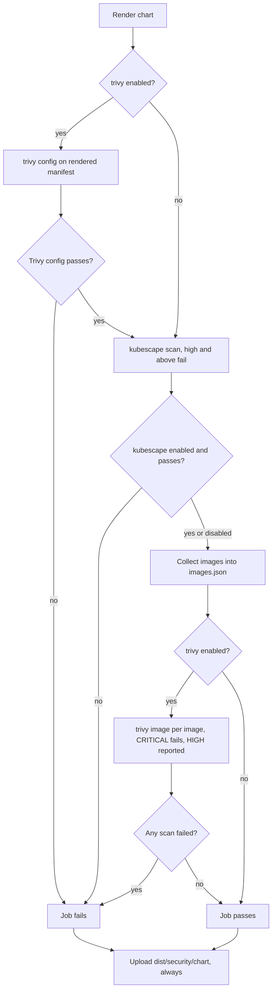

# Helm Security (reusable workflow)

**File:** `.github/workflows/_managed-helm-security.yml`

Renders one chart from `charts/<chart>` and scans it with Trivy and Kubescape.

## Inputs

| Input | Type | Required | Description |
|---|---|---|---|
| `chart` | string | yes | Chart directory name under `charts/` |
| `summary-layout` | string | no (`classic`) | Job summary layout: `classic`, `flat`, `sections`, `counts` or `expiry` |
| `verify-exceptions` | boolean | no (`false`) | Require a valid cosign signature bundle for each exception file |

## Steps

1. Installs Helm `v4.3.2` and the `helm-ci` package.
2. Runs `security-scan setup-tools --tool trivy --tool kubescape`, which installs Trivy and Kubescape.
3. Runs `security-scan chart "$CHART"`.

4. Uploads `dist/security/<chart>` as `chart-security-<chart>`, even when the scan fails.

When both `trivy` and `kubescape` are disabled in `.ciconfig`, the chart gets no security job. See [Per-chart opt-out](#per-chart-opt-out).

## Pinned tools

Trivy `v0.76.2` and Kubescape `v4.0.21` are downloaded and checksum-verified by the `helm-ci` package.

## Kubescape

Runs `kubescape scan` on the rendered manifest with `--severity-threshold high`. The job fails when a failed control is high severity or above. The full report is written to `kubescape.json` in the report directory.

Kubescape runs after the Trivy config scan when `trivy` is enabled, and only if that scan passes. When `trivy` is disabled, Kubescape runs on its own. Set `kubescape: false` in `.ciconfig` to skip it.

## Per-chart opt-out

Each security scanner can be turned off per chart in `charts/<chart>/.ciconfig`. Both default to `true`:

| Key | Effect when `false` |
|---|---|
| `trivy` | Skips the Trivy config scan and the Trivy image scan |
| `kubescape` | Skips the Kubescape scan |

When both are `false`, the chart is left out of the security matrix, and the publish workflow skips its scan check for that chart. A chart with only one scanner disabled still gets a security job. The keys and an example are in [Chart configuration](../5-configuration/5.2-chart-configuration.md).

## Exclusions

When `charts/<chart>/exceptions.yaml` exists (`.yml` and `.json` are also accepted), its `trivy` section is passed to Trivy as an ignore file, and its `kubescape` section is passed to Kubescape. Image vulnerability scans use neither section. The file format, scope, and review guidance are in [Chart exclusions](../5-configuration/5.1-chart-exclusions.md). When `verify-exceptions` is `true`, the file must carry a valid signature bundle, as described there.

## Job summary

The scan writes these tables to the job summary:

| Table | Appears when |
|---|---|
| `Trivy misconfigurations: <chart>` | `trivy config` reports unsuppressed HIGH or CRITICAL findings |
| `Trivy exclusions: <chart>` | An exception file exists. Lists every active exclusion |
| `Excluded misconfigurations: <chart>` | An exception file exists. Lists findings hidden by the exclusions |
| `HIGH image vulnerabilities: <chart>` | The chart renders images. One row per image, or `scan failed` |

The exclusion tables are informational and do not fail the job. Kubescape has no summary table; read `kubescape.json` for its findings.
