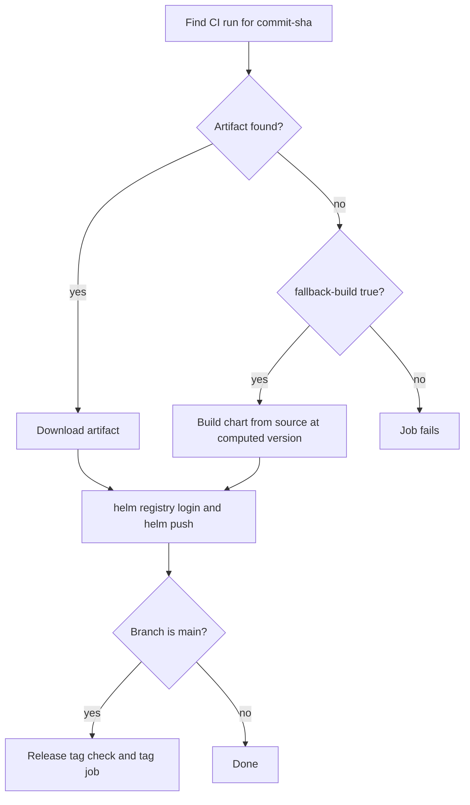

# Helm Publish (reusable workflow)

**File:** `.github/workflows/_reusable-helm-publish.yml`

Pushes a packaged chart to an OCI registry. It reuses the artifact from the successful CI run for the same commit, so the published chart is the one that passed CI.

## Inputs

| Input | Type | Default | Description |
|---|---|---|---|
| `commit-sha` | string | required | Commit whose CI run provides the artifact |
| `chart-path` | string | `.` | Chart directory, used when `fallback-build` runs |
| `helm-version` | string | `v4.3.2` | Helm version to install |
| `registry` | string | `ghcr.io` | OCI registry host |
| `registry-namespace` | string | `""` | Namespace; empty uses the lowercased repository owner |
| `environment` | string | `production` | GitHub environment that gates the job |
| `artifact-name` | string | `helm-chart` | Artifact produced by Helm CI |
| `ci-workflow-name` | string | `Helm CI — Branch push` | CI run name to download the artifact from |
| `fallback-build` | boolean | `false` | Build from source when no CI artifact is found (bypasses the CI gate) |

## Secrets

| Secret | Required | Description |
|---|---|---|
| `gh-pat` | no | Token for pushing the release tag when `GITHUB_TOKEN` cannot push tags |

## Outputs

- `published`: `true` when the chart was pushed.
- `package`: name and version of the pushed package (`name-version`).
- `tag`: release tag `chart/<name>/v<version>` created on `main`, empty otherwise.

## Flow

1. Finds a successful CI run for `commit-sha`.
2. Downloads the artifact. When there is none, the job fails unless `fallback-build` is true, in which case it runs `chart-pipeline next-version` and builds the chart from source.
3. Logs in with `GITHUB_TOKEN` and runs `helm push` to `oci://<registry>/<namespace>`.
4. On `main`, fails if the tag `chart/<name>/v<version>` already exists on origin. Otherwise the `tag` job pushes the tag.

Permissions required: `packages: write`, `actions: read`. The `tag` job requires `contents: write`.
