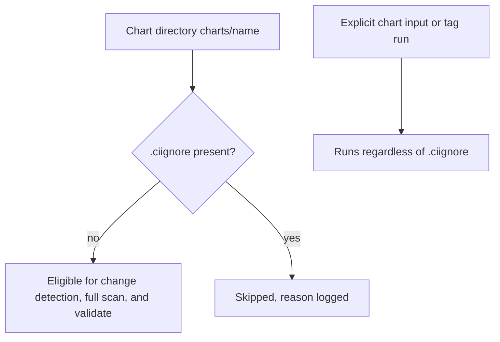

# Chart exclusions

Two mechanisms let a repository opt charts out of the pipeline or suppress known findings:

| Mechanism | Location | Effect |
|---|---|---|
| `.ciignore` marker | `charts/<name>/.ciignore` | Skips the chart in change detection, full scans, and validation |
| Exception file | `charts/<name>/exceptions.yaml` (`.yml` or `.json` also accepted) | Suppresses specific Trivy misconfiguration IDs and Kubescape controls for the chart |

Both mechanisms are keyed by the chart directory name, `<name>`.

## Skipping a chart with `.ciignore`

Create an empty or one-line `.ciignore` file in the chart directory. The pipeline reads the file, trims it, and logs its content as the reason for skipping:

```text
Skipped by CI and release discovery: renders kyverno.io ClusterPolicy resources whose CRDs are not installed in the CI cluster.
```

Keep the reason to one line. It appears in the workflow log every time the chart is skipped.



### Where `.ciignore` applies

| Path through the pipeline | Ignored chart handled? |
|---|---|
| Change detection on push or pull request (`chart-pipeline changed`) | Not selected, even when its files changed |
| Dependents of a changed chart | An ignored dependent is not selected |
| Full scan (`full-scan: true`, `changed --all`) | Not selected |
| Validation of all charts (`validate`) | Not validated |
| Explicit `chart` input on the pipeline | Not checked. The chart runs |
| Tag-based run (`chart/<name>/v<version>`) | Not checked. The chart runs |

The explicit `chart` input and tag-based runs exist for manual or release use, so they intentionally override the marker. Do not rely on `.ciignore` to block a manual run.

The security scan is only reached for charts that the pipeline selects, so an ignored chart is not scanned in a normal run.

## Suppressing findings

Create `charts/<name>/exceptions.yaml` in the chart directory. The file is optional. A chart may have only one exception file. It has two optional sections: `trivy` for Trivy misconfigurations, and `kubescape` for Kubescape controls. The security scan passes each section to its scanner.

The legacy file `security/exceptions/<name>.yaml` in the repository root is also recognised. A chart must not have more than one exception file; if it has both, the scan fails. Move existing files into the chart directory.

Example for the SpotINFO chart `spotinfo-metallb`:

```yaml
trivy:
  misconfigurations:
    - id: KSV-0005
      statement: Upstream controller requires hostNetwork; tracked in ISSUE-123
kubescape:
  - name: metallb-controller-root-filesystem
    policyType: postureExceptionPolicy
    actions:
      - alertOnly
    resources:
      - designatorType: Attributes
        attributes:
          kind: Deployment
          name: metallb-controller
    posturePolicies:
      - controlID: C-0017
```

Trivy entries under `trivy.misconfigurations` have these fields:

| Field | Required | Description |
|---|---|---|
| `id` | yes | Trivy check ID, for example `KSV-0005` |
| `statement` | yes | Reason for the exclusion. Shown in the job summary and logs |

Entries under `kubescape` use the Kubescape exception format. Set `policyType: postureExceptionPolicy`, list the control in `posturePolicies`, and narrow `resources` to the workloads the finding applies to.

The `trivy` section is written to an ignore file for `trivy config`, and the `kubescape` section is passed to `kubescape scan --exceptions`.

### What an exclusion covers

- **Scope:** the `trivy` section applies to `trivy config` on the rendered chart. The `kubescape` section applies to the Kubescape scan of the same manifest. Image vulnerability scans and the repository secret scan read neither section.
- **Matching:** by check ID only. An ID excludes every matching resource in that chart, not one specific resource.
- **Rendering:** the chart is rendered with its default values before the scan.

### Writing a good exclusion

- Write a specific `statement` that explains why the finding is accepted, for example "Upstream controller requires hostNetwork; tracked in ISSUE-123". The placeholder text `default set of exclusions` is not sufficient for review.
- Keep the exception file in the same pull request as the chart change that needs it.
- Remove the entry once the finding is fixed. Review the exception file when a finding changes, because an entry that no longer matches anything is not reported.

## Signature verification

Set `verify-exceptions: true` on the Helm Security workflow, or `security-verify-exceptions: true` on the Helm Chart Pipeline, to require a signed exception file. The default is `false`.

When enabled, each exception file needs a sigstore bundle next to it named `<file>.sigstore.json`, for example `charts/<name>/exceptions.yaml.sigstore.json`. The bundle must pass `cosign verify-blob` with a certificate identity matching `^https://github.com/ITlusions/` and the GitHub Actions OIDC issuer. If the bundle is missing or does not verify, the scan fails and no exclusions are applied.

## Code owners

Signing proves who produced a file, not who approved it. To require approval, copy [CODEOWNERS](../../.github/CODEOWNERS) to `.github/CODEOWNERS` in the calling repository and replace the owner handle with your own team. The file assigns review of exception files, `.ciignore` files, and workflows to the platform team.

CODEOWNERS only takes effect when branch protection on the default branch enables "Require review from Code Owners". Without that setting, the file has no effect on merges.

## What the security run reports

The security scan writes these job summary tables to `GITHUB_STEP_SUMMARY`. They are the only place the exclusions are visible to reviewers without reading the log.

| Summary table | Appears when |
|---|---|
| `Trivy misconfigurations: <name>` | `trivy config` reports unsuppressed HIGH or CRITICAL findings |
| `Trivy exclusions: <name>` | The chart has an exception file. Lists every active exclusion |
| `Excluded misconfigurations: <name>` | The chart has an exception file and the unfiltered report succeeds. Lists findings that the exclusions hide |
| `HIGH image vulnerabilities: <name>` | The rendered chart has images. Counts HIGH findings per image, or shows `scan failed` |

The exclusion tables are informational and do not fail the job. A failed scanner is recorded in `scan-errors.json` in the report directory. Kubescape writes its full report to `kubescape.json` and has no summary table.

## Related pages

- [Pipeline workflow](../2-workflows/2.1-pipeline-workflow.md) describes chart selection.
- [Helm Security](../2-workflows/2.3-helm-security-workflow.md) describes the security scan steps.
- [helm-ci CLI](../3-cli/3.1-helm-pipeline-cli.md) lists the `chart-pipeline` and `security-scan` commands.
