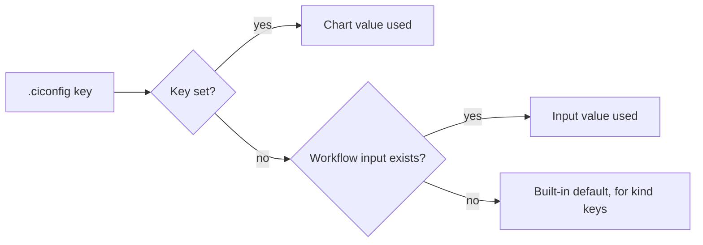
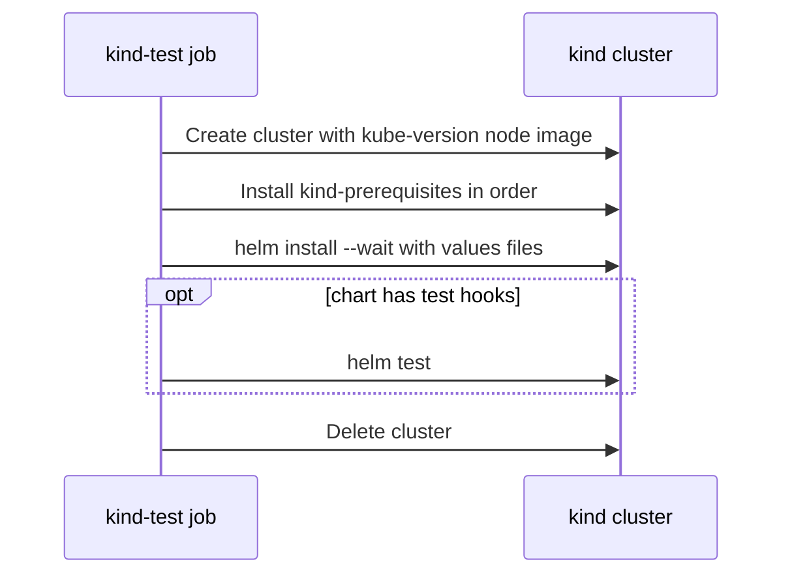

# Chart configuration

A chart can override selected pipeline settings with a `.ciconfig` file in its chart directory:

```text
charts/<name>/.ciconfig
```

The file is optional. Every key is optional. A missing key falls back to the workflow input of the same purpose, or to the workflow default.

## Keys

| Key | Type | Overrides input | Default when unset |
|---|---|---|---|
| `timeout-minutes` | integer | none (job timeout) | `360` |
| `helm-version` | string | `helm-version` | workflow input |
| `kube-version` | string | `kube-version` | workflow input |
| `kubeconform` | boolean | `kubeconform` | workflow input |
| `values-files` | list of paths | `values-files` | workflow input |
| `kind-test` | boolean or list of scenarios | none (opt-in) | `false`, kind test job skipped |
| `kind-namespace` | string | none | `ci-test` |
| `kind-timeout` | integer (minutes) | none | `5` |
| `kind-values-files` | list of paths | none | the chart `values-files` |
| `kind-prerequisites` | list of charts or manifests | none | nothing installed before the chart |
| `trivy` | boolean | none (per-chart opt-out) | `true`, Trivy config and image scans run |
| `kubescape` | boolean | none (per-chart opt-out) | `true`, Kubescape scan runs |

Unknown keys fail the pipeline. This catches typos such as `timeout` instead of `timeout-minutes`.

## Example

```yaml
# charts/myapp/.ciconfig
timeout-minutes: 45
helm-version: v4.2.0
kube-version: 1.36.4
kubeconform: false
trivy: false
kubescape: true
values-files:
  - charts/myapp/ci/default-values.yaml
  - charts/myapp/ci/ha-values.yaml
```

Setting both `trivy` and `kubescape` to `false` skips the security scan for the chart entirely, before the chart is rendered.

## How it is applied

The `config` job of the reusable workflow `_reusable-helm-ci.yml` reads `.ciconfig` with `chart-pipeline chart-config` and exposes the values as job outputs. The `lint` and `package` jobs use these outputs and fall back to the workflow inputs when a key is unset.



## Kind install and test

Set `kind-test: true` to run the `kind-test` job after `lint`. The job creates a temporary kind cluster with the chart's `kube-version` node image (default `1.36.4`), installs the chart with `helm install --wait` using the values files, runs `helm test` when the chart has test hooks, and deletes the cluster. The job is skipped unless the key is set, so charts that need external services are not affected.



```yaml
# charts/myapp/.ciconfig
kind-test: true
```

Set `kind-test` to a list of named scenarios to run each one in its own matrix job and its own cluster. A scenario without `values-files` uses the chart `values-files`.

```yaml
# charts/myapp/.ciconfig
kind-test:
  - name: minimal
  - name: ha
    values-files:
      - charts/myapp/ci/ha-values.yaml
```

Scenario names must be lowercase letters, digits, and hyphens, and must be unique within the chart.

Use `kind-prerequisites` to install dependencies into the cluster before the chart. Each entry is either a Helm chart, installed with `helm upgrade --install`, or a manifest file or directory, applied with `kubectl apply`.

```yaml
# charts/myapp/.ciconfig
kind-prerequisites:
  - name: cert-manager
    namespace: cert-manager
    chart: jetstack/cert-manager
    repo: https://charts.jetstack.io
    version: 1.20.0
  - name: crds
    manifests: charts/myapp/ci/crds.yaml
```

## Reducing cost

Cost is billed per job minute, so the cheapest run is the one with the fewest jobs. The settings below apply to a single chart. See the [cost estimate](../2-workflows/2.1-pipeline-workflow.md#cost-estimate) for the rate and the assumed job durations.

| Goal | Setting | Effect |
|---|---|---|
| Skip a chart in every job | `.ciignore` file in the chart directory | Removes the chart from all matrix jobs, the largest saving. See [Chart exclusions](5.1-chart-exclusions.md). |
| Skip the security job for a chart | `trivy: false` and `kubescape: false` | The `chart-security` job is not scheduled for the chart. |
| Run only one security scanner | `trivy: false` or `kubescape: false` | The scanner that remains still runs, so the job still costs minutes. |
| Skip kind tests | Leave `kind-test` unset | The `kind-test` job is not scheduled. This is the default. |
| Reduce kind test jobs | Fewer entries in `kind-test` | Each scenario is one extra matrix job with its own cluster. |
| Cap runaway jobs | `timeout-minutes` | Stops a hung job after the given number of minutes. Use a value near the normal run time. |
| Fail faster in kind tests | `kind-timeout` | Stops waiting for installs sooner when a chart is broken. |
| Skip the kubeconform step | `kubeconform: false` | Saves the kubeconform install and check, typically under a minute. |

Settings in `.ciconfig` do not reduce the matrix. Every selected chart still runs for each profile and Kubernetes version that the caller passes to the pipeline. To reduce those combinations, change the `profiles` and `scheduled-kube-versions` inputs in the caller workflow.

The `repository-secrets` job runs once per workflow run and cannot be turned off from `.ciconfig`.

### Example: cost-sensitive chart

```yaml
# charts/myapp/.ciconfig
timeout-minutes: 20
kubeconform: false
trivy: false
kubescape: false
kind-timeout: 3
```

This chart keeps the lint and package jobs and skips the security scan and kubeconform. Its kind tests stay off, because `kind-test` is not set.
